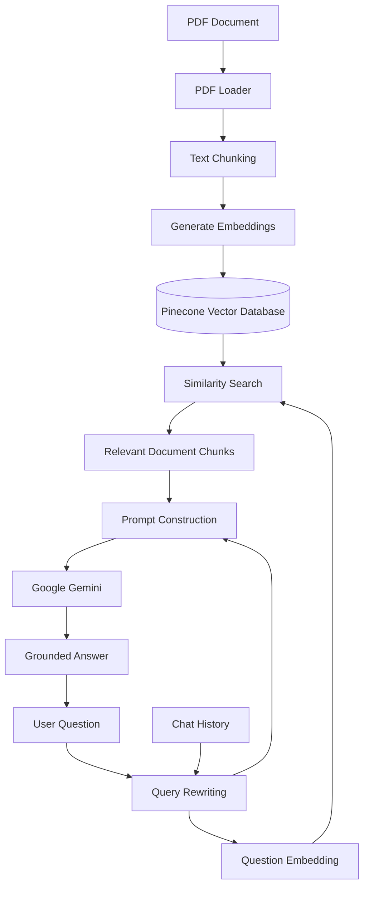

# 🤖 RAG-Based Document Q&A System

> An AI-powered Retrieval-Augmented Generation (RAG) system that allows users to ask questions about PDF documents and receive context-aware answers grounded in the document content.

[](https://nodejs.org/)
[](https://developer.mozilla.org/en-US/docs/Web/JavaScript)
[](https://www.langchain.com/)
[](https://ai.google.dev/)
[](https://www.pinecone.io/)

---

## 📌 Overview

The **RAG-Based Document Q&A System** is an AI application designed to answer questions from the actual content of PDF documents.

Instead of sending the entire document directly to an LLM, the system uses **Retrieval-Augmented Generation (RAG)** to:

1. Load and process the PDF.
2. Split the document into smaller chunks.
3. Generate embeddings for the chunks.
4. Store the embeddings in a vector database.
5. Retrieve the most relevant chunks for a user's question.
6. Rewrite follow-up questions into standalone queries.
7. Provide the retrieved context to Google Gemini.
8. Generate an answer based on the relevant document content.

This approach helps the application provide more **context-aware and document-grounded responses**.

---

# 🧠 What is RAG?

**Retrieval-Augmented Generation (RAG)** combines information retrieval with Large Language Models.

Instead of asking an LLM to answer a question only from its pretrained knowledge, RAG first retrieves relevant information from an external knowledge source and then provides that information to the LLM.

### Traditional LLM

```text
User Question
      ↓
     LLM
      ↓
   Answer
```

### RAG-Based System

```text
User Question
      ↓
   Retrieval
      ↓
Relevant Document Chunks
      ↓
      LLM
      ↓
Grounded Answer
```

This project implements the second approach.

---

# ✨ Features

### 📄 PDF Processing
Loads PDF documents and divides their content into smaller chunks suitable for embedding and retrieval.

### 🔢 Embeddings
Converts document chunks and user queries into numerical vector representations.

### 🗄️ Vector Database
Stores document embeddings in **Pinecone** for efficient semantic similarity search.

### 🔍 Semantic Retrieval
Retrieves the most relevant document chunks based on the meaning of the user's question rather than simple keyword matching.

### 🔄 Query Rewriting
Follow-up questions are rewritten into standalone questions using conversation history.

For example:

```text
User:
What is machine learning?

User:
What are its applications?
```

The second question can be rewritten as:

```text
What are the applications of machine learning?
```

This improves retrieval quality.

### 🤖 Gemini-Powered Answers
Google Gemini uses the retrieved document context to generate the final response.

### 🛠️ Function Calling
The project also explores **function/tool calling** concepts for building more capable AI agent workflows.

---

# 🏗️ System Architecture



---

# 🔄 Complete Workflow

## 1️⃣ Document Ingestion

The PDF is loaded and its text is extracted.

```text
PDF
 ↓
Text Extraction
 ↓
Document Content
```

---

## 2️⃣ Chunking

Large document content is divided into smaller chunks.

```text
Large Document
      ↓
 ┌─────────────┐
 │   Chunk 1   │
 ├─────────────┤
 │   Chunk 2   │
 ├─────────────┤
 │   Chunk 3   │
 ├─────────────┤
 │     ...     │
 └─────────────┘
```

Chunking makes it possible to search only the relevant parts of a large document.

---

## 3️⃣ Embedding Generation

Each chunk is converted into a vector representation.

```text
Document Chunk
      ↓
Embedding Model
      ↓
Numerical Vector
      ↓
Pinecone
```

The same embedding process is applied to the user's question during retrieval.

---

## 4️⃣ Vector Storage

The generated vectors are stored in **Pinecone**.

```text
Chunk
  ↓
Embedding
  ↓
Pinecone
  ↓
Vector Index
```

Pinecone allows the system to efficiently search for semantically similar content.

---

## 5️⃣ Query Rewriting

When a user asks a follow-up question, the system uses conversation history to rewrite it into a standalone query.

```text
Chat History
     +
Follow-up Question
     ↓
Query Rewriting
     ↓
Standalone Question
```

This improves the quality of semantic retrieval.

---

## 6️⃣ Similarity Search

The rewritten question is converted into an embedding and searched against the vectors stored in Pinecone.

```text
User Question
      ↓
Question Embedding
      ↓
Pinecone Search
      ↓
Top Relevant Chunks
```

---

## 7️⃣ Answer Generation

The retrieved chunks are passed to Gemini along with the user's question.

```text
Relevant Context
       +
User Question
       ↓
Google Gemini
       ↓
Final Answer
```

---

# 🧰 Tech Stack

| Technology | Purpose |
|---|---|
| **Node.js** | Backend runtime |
| **JavaScript** | Application logic |
| **LangChain** | LLM and RAG workflow orchestration |
| **Google Gemini API** | LLM and embedding capabilities |
| **Pinecone** | Vector database and semantic search |
| **PDF Loader** | PDF document processing |
| **dotenv** | Environment variable management |

---

# 📂 Project Structure

```text
RAG-based-QA/
│
├── index.js
│   └── PDF ingestion, chunking, embeddings and Pinecone storage
│
├── query.js
│   └── Query rewriting, retrieval and answer generation
│
├── document.pdf
│   └── Sample PDF document
│
├── package.json
│
├── package-lock.json
│
├── .gitignore
│
└── README.md
```

---

# ⚙️ Getting Started

## Prerequisites

Make sure you have the following installed:

- Node.js 18 or higher
- npm
- Google Gemini API key
- Pinecone account
- Pinecone index

---

## 1. Clone the Repository

```bash
git clone https://github.com/shubham2467/RAG-based-QA.git
```

```bash
cd RAG-based-QA
```

---

## 2. Install Dependencies

```bash
npm install
```

---

## 3. Configure Environment Variables

Create a `.env` file in the root directory.

```env
GEMINI_API_KEY=your_gemini_api_key
PINECONE_API_KEY=your_pinecone_api_key
PINECONE_INDEX_NAME=your_index_name
```

> ⚠️ Never commit your `.env` file or expose API keys publicly.

---

# ▶️ Running the Project

## Step 1 — Add Your PDF

Place your PDF document inside the project directory.

Example:

```text
RAG-based-QA/
│
├── document.pdf
├── index.js
└── query.js
```

Update the PDF path in `index.js` if required.

---

## Step 2 — Ingest the Document

Run:

```bash
node index.js
```

This process:

```text
PDF
 ↓
Text Extraction
 ↓
Chunking
 ↓
Embeddings
 ↓
Pinecone
```

---

## Step 3 — Ask Questions

Run:

```bash
node query.js
```

You can now ask questions related to the indexed document.

---

# 💬 Example

Suppose the PDF contains information about **Artificial Intelligence**.

You could ask:

```text
What is artificial intelligence?
```

The system retrieves the relevant document chunks and sends them to Gemini.

```text
Question
   ↓
Query Rewriting
   ↓
Embedding
   ↓
Pinecone
   ↓
Relevant Chunks
   ↓
Gemini
   ↓
Answer
```

---

# 🔍 Why RAG Instead of Sending the Whole PDF?

Sending an entire document directly to an LLM can become inefficient as document size increases.

RAG solves this by retrieving only the information relevant to the current question.

### Without RAG

```text
Large PDF
    ↓
Entire Document
    ↓
LLM
    ↓
Answer
```

### With RAG

```text
Large PDF
    ↓
Chunks
    ↓
Embeddings
    ↓
Vector Database
    ↓
Relevant Chunks
    ↓
LLM
    ↓
Answer
```

This architecture makes the system more suitable for working with larger knowledge bases.

---

# 🧩 Key Concepts Demonstrated

This project demonstrates practical implementation of:

- Retrieval-Augmented Generation (RAG)
- Document ingestion
- Text chunking
- Embeddings
- Vector databases
- Semantic similarity search
- Query rewriting
- Conversation history
- Prompt construction
- LLM integration
- Google Gemini API
- LangChain
- Pinecone
- Function/tool calling
- Environment variable management
- Node.js backend development

---

# 🧠 RAG Pipeline at a Glance

```text
                 DOCUMENT INGESTION
                         │
                         ▼
                  ┌─────────────┐
                  │ PDF Loader  │
                  └──────┬──────┘
                         │
                         ▼
                  ┌─────────────┐
                  │  Chunking   │
                  └──────┬──────┘
                         │
                         ▼
                  ┌─────────────┐
                  │ Embeddings  │
                  └──────┬──────┘
                         │
                         ▼
                ┌──────────────────┐
                │     Pinecone     │
                │  Vector Database │
                └────────┬─────────┘
                         │
                         │
                         ▼
                  USER QUERY
                         │
                         ▼
                ┌─────────────────┐
                │ Query Rewriting │
                └────────┬────────┘
                         │
                         ▼
                ┌─────────────────┐
                │ Question Vector │
                └────────┬────────┘
                         │
                         ▼
                ┌─────────────────┐
                │ Similarity Search│
                └────────┬────────┘
                         │
                         ▼
                ┌─────────────────┐
                │ Relevant Chunks │
                └────────┬────────┘
                         │
                         ▼
                ┌─────────────────┐
                │ Google Gemini   │
                └────────┬────────┘
                         │
                         ▼
                    FINAL ANSWER
```

---

# 🚀 Future Improvements

Some possible improvements for the project include:

- [ ] Build a web-based chat interface
- [ ] Support multiple PDF documents
- [ ] Add document management
- [ ] Add conversation persistence
- [ ] Add streaming responses
- [ ] Add source/citation references for retrieved chunks
- [ ] Improve chunking strategies
- [ ] Add authentication
- [ ] Add document-level access control
- [ ] Deploy the application to the cloud
- [ ] Add evaluation metrics for retrieval quality

---

# 📈 Learning Outcomes

Through this project, I gained practical experience in building an AI application that combines:

```text
Backend Development
        +
LLM Integration
        +
Vector Search
        +
Retrieval-Augmented Generation
        +
AI Application Architecture
```

The project helped me understand how modern AI applications can combine traditional backend systems with LLMs and external knowledge sources.

---

# 👨‍💻 Author

## Shubham Kumar

**Backend Development | Generative AI | RAG Systems**

I'm interested in building backend systems and AI-powered applications using modern technologies such as Node.js, Express.js, MongoDB, LangChain, Gemini, and vector databases.

### Connect With Me

- 💼 [LinkedIn](https://www.linkedin.com/in/shubham-kumar-043686323/)
- 🐙 [GitHub](https://github.com/shubham2467)

---

⭐ If you found this project interesting, feel free to explore the repository.